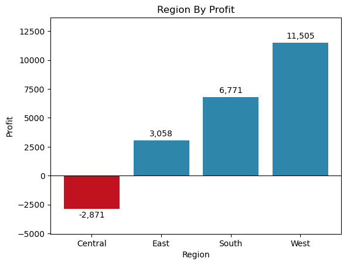
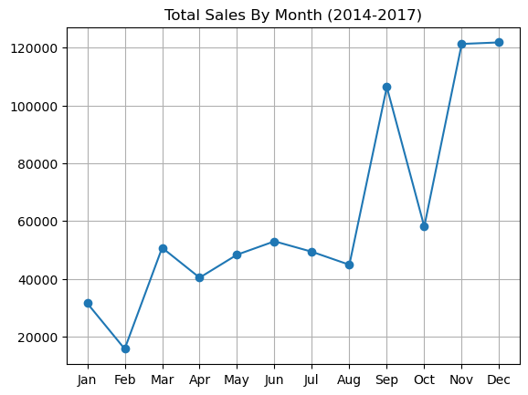
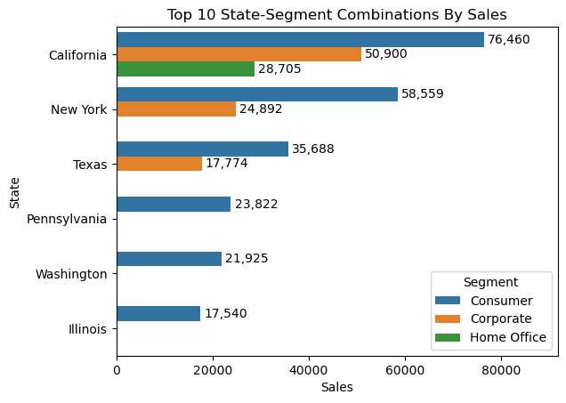

# Furniture Sales EDA

Exploratory data analysis of furniture sales using Python (Pandas, NumPy, Matplotlib, Seaborn) to uncover sales trends, top products, and profit drivers.

## Project Overview

This project explores a Superstore-style retail dataset limited to the **Furniture** category. The goal is to understand where revenue comes from, which products and regions drive (or hurt) profit, and how shipping and seasonality behave.

## Dataset

| Item | Detail |
|---|---|
| File | `Dataset.xlsx` |
| Rows / Columns | 2,121 rows x 20 columns (2,120 after removing 1 duplicate) |
| Period | January 2014 - December 2017 |
| Country | United States |
| Coverage | 1,764 unique orders, 707 customers, 48 states, 371 cities |
| Missing values | None |

**Key columns:** Order ID, Order Date, Ship Date, Ship Mode, Customer ID, Segment, Region, State, City, Sub-Category, Product Name, Sales, Quantity, Profit, Duration, Month.

**Sub-Categories:** Bookcases, Chairs, Furnishings, Tables.
**Segments:** Consumer, Corporate, Home Office.
**Regions:** East, West, Central, South.
**Ship Modes:** Standard Class, Second Class, First Class, Same Day.

## Workflow

1. **Import libraries** - NumPy, Pandas, Matplotlib, Seaborn
2. **Load data** - read `Dataset.xlsx` with Pandas
3. **Inspect structure** - `info()`, `describe()`, null check, shape, duplicates
4. **Clean** - dropped 1 duplicate row; extracted numeric days from the text `Duration` column (e.g. "3- days" -> 3)
5. **EDA**
   - Numerical features: KPIs, distributions (histograms), Sales vs Profit scatter
   - Categorical features: counts and shares for Ship Mode, Segment, Region, Sub-Category, Duration
   - Business questions answered with grouped charts

## Key Metrics (KPIs)

| Metric | Value |
|---|---|
| Total Revenue | $741,718.42 |
| Total Profit | $18,463.33 |
| Profit Margin | 2.49% |
| Total Orders | 1,764 |
| Units Sold | 8,026 |
| Average Order Value | $420.48 |

## Key Insights

- **Thin margins:** revenue is $741.7K but profit is only $18.5K (2.49%), so the category earns very little on each dollar sold.
- **Profit is very uneven:** profit per order ranges from -$1,862 to +$1,013, and more than 25% of order lines lose money (25th percentile profit is negative).
- **Chairs are the top sub-category by sales** at about $328K.
- **Worst losses come mostly from Tables**, e.g. conference and round tables in the South and West, where deep discounting appears to push orders below cost. One Bookcase order in the East also lost about $1,665.
- **Consumer is the largest segment** (about 52% of order lines).
- **Standard Class is the most used ship mode** (about 59% of order lines), and the most common delivery time is 4 days.
- **West has the most order lines** (707), and California is the top state by order count (444).
- **December is the busiest month** by order lines.
- **Central is the only unprofitable region:** it lost about $2,871, while West earned $11,505, South $6,771 and East $3,058. West alone accounts for more than 60% of total profit.
- **Sales are strongly seasonal:** monthly sales stay around $40K-$55K for most of the year, jump in September (about $106K), dip in October, then peak in November and December (about $121K-$122K each). February is the weakest month (about $16K).
- **California leads in sales:** its Consumer segment is the top state-segment combination ($76,460), followed by New York Consumer ($58,559) and California Corporate ($50,900). Consumer is the top segment in every state shown, and Texas, New York and California are the only states with a sizeable Corporate segment.

## Visualizations

### Region By Profit


### Total Sales By Month (2014-2017)


### Top 10 State-Segment Combinations By Sales


## Business Questions Explored

- Is there a relationship between sales and profit?
- Which orders lost the most money?
- Which region yields the highest sales, and which regions are profitable?
- Which sub-category generates the most sales?
- Which months have the highest sales?
- Which state-segment combinations bring in the most sales?
- Which ship mode delivers the fastest?

## Tools

- Python 3
- Pandas, NumPy
- Matplotlib, Seaborn
- Jupyter Notebook

## Repository Structure

```
furniture-sales-eda/
├── Furniture/
│   ├── Furniture_data.ipynb   # analysis notebook
│   └── Dataset.xlsx           # dataset
├── images/                    # charts used in this README
└── README.md
```

## How to Run

```bash
pip install pandas numpy matplotlib seaborn openpyxl jupyter
jupyter notebook Furniture/Furniture_data.ipynb
```

Run the notebook from inside the `Furniture` folder so `Dataset.xlsx` is found.

## Author

**Habiba Mostafa** -  Data Analyst
